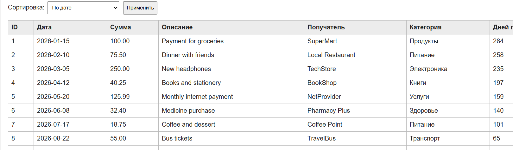
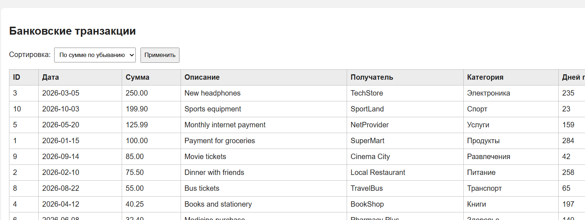
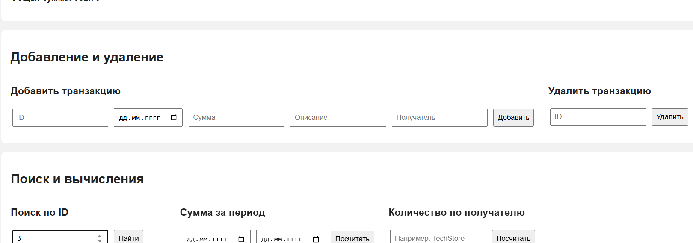
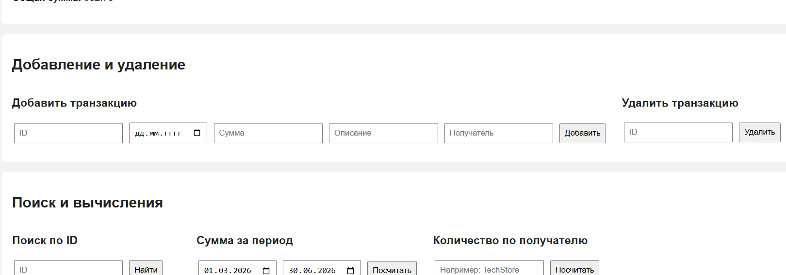
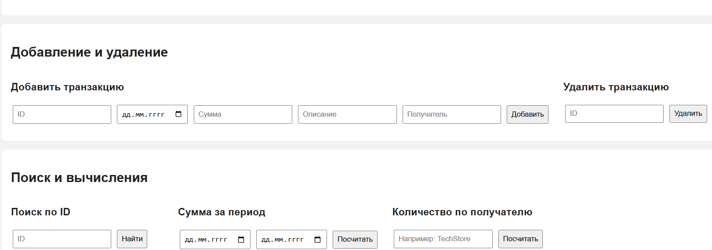
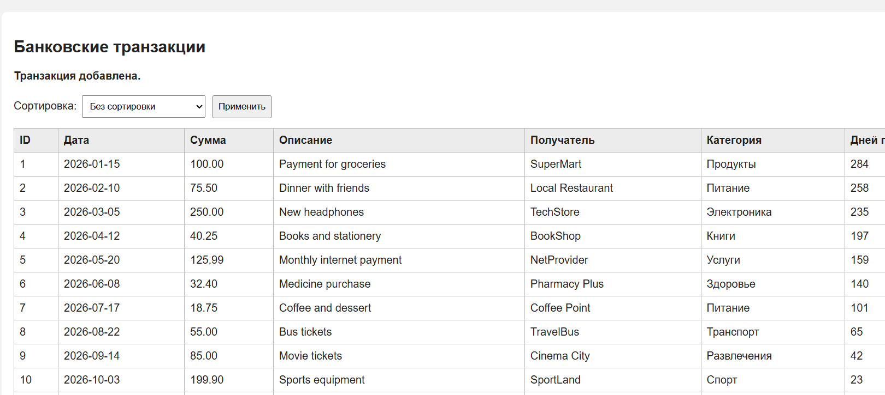
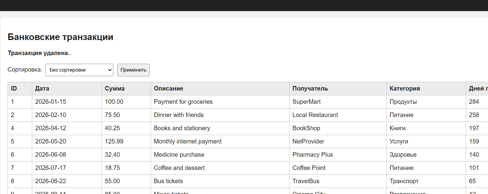

# Лабораторная работа №5
## Объектно-ориентированное программирование в PHP

**Студент:** Rotari Artemii  
**Группа:** I2502(RU)

---

## Цель работы

Цель работы — познакомиться с основами ООП в PHP и переделать работу с банковскими транзакциями так, чтобы данные и действия были разделены между классами.

В работе используются:

- класс `Transaction`;
- класс `TransactionRepository`;
- класс `TransactionManager`;
- класс `TransactionTableRenderer`;
- интерфейс `TransactionStorageInterface`.

Также используется строгая типизация:

```php
declare(strict_types=1);
```

---

## 1. Класс Transaction

Класс `Transaction` описывает одну банковскую транзакцию.

В нём хранятся:

- `id`;
- `date`;
- `amount`;
- `description`;
- `merchant`.

Все свойства сделаны `private`, поэтому напрямую снаружи к ним обращаться нельзя.

Значения передаются через конструктор:

```php
public function __construct(
    private int $id,
    private string $date,
    private float $amount,
    private string $description,
    private string $merchant
)
```

Для получения значений используются getter-методы:

```php
getId()
getDate()
getAmount()
getDescription()
getMerchant()
```

Также есть метод:

```php
getDaysSinceTransaction(): int
```

Он считает, сколько дней прошло с даты транзакции до текущего дня через `DateTime`.

---

## 2. Интерфейс TransactionStorageInterface

Интерфейс задаёт список методов, которые должно иметь хранилище транзакций:

```php
addTransaction(Transaction $transaction): void
removeTransactionById(int $id): void
getAllTransactions(): array
findById(int $id): ?Transaction
```

Интерфейс не хранит данные сам, а только задаёт правила, какие методы должны быть реализованы.

---

## 3. Класс TransactionRepository

`TransactionRepository` реализует интерфейс:

```php
class TransactionRepository implements TransactionStorageInterface
```

Внутри класса находится приватный массив:

```php
private array $transactions = [];
```

Через методы класса можно:

- добавить транзакцию;
- удалить транзакцию по ID;
- получить все транзакции;
- найти транзакцию по ID.

Сам массив снаружи недоступен.

---

## 4. Класс TransactionManager

`TransactionManager` отвечает за вычисления и сортировку.

Он получает хранилище через конструктор:

```php
public function __construct(
    private TransactionStorageInterface $repository
)
```

Реализованы методы:

```php
calculateTotalAmount(): float
calculateTotalAmountByDateRange(string $startDate, string $endDate): float
countTransactionsByMerchant(string $merchant): int
sortTransactionsByDate(): array
sortTransactionsByAmountDesc(): array
```

То есть менеджер не хранит транзакции сам, а получает их из репозитория.

---

## 5. Класс TransactionTableRenderer

`TransactionTableRenderer` отвечает только за HTML-таблицу.

Класс объявлен как:

```php
final class TransactionTableRenderer
```

Основной метод:

```php
render(array $transactions): string
```

Он формирует таблицу со следующими столбцами:

- ID;
- дата;
- сумма;
- описание;
- получатель;
- категория;
- количество прошедших дней.

Категория определяется по получателю внутри отдельного приватного метода.

---

## 6. Начальные данные

В программе создаётся 10 объектов `Transaction`.

Используются разные:

- даты;
- суммы;
- описания;
- получатели.

После создания все объекты добавляются в `TransactionRepository`.

---

## 7. Основной результат

При обычном запуске выводятся все транзакции.



Общая сумма:

```text
982.79
```

---

## 8. Сортировка

### По дате


### По сумме по убыванию



Для сортировки используется `usort()`.

---

## 9. Поиск по ID

Поиск выполняется через метод:

```php
findById(int $id): ?Transaction
```

Пример для ID `3`:



Результат:

```text
New headphones — 250.00
```

---

## 10. Сумма за период

Для периода:

```text
01.03.2026 — 30.06.2026
```

получен результат:

```text
448.64
```



---

## 11. Количество транзакций по получателю

Для получателя:

```text
TechStore
```

получено:

```text
1
```



---

## 12. Добавление транзакции

Для проверки была добавлена новая транзакция:

```text
ID: 11
Дата: 15.10.2026
Сумма: 300
Описание: New keyboard
Получатель: TechMarket
```

После добавления общая сумма стала:

```text
1282.79
```



---

## 13. Удаление транзакции

Для проверки была удалена транзакция с ID `3`.

После удаления общая сумма стала:

```text
732.79
```



---

## Контрольные вопросы

### 1. Зачем нужна строгая типизация в PHP?

Строгая типизация помогает контролировать типы данных, которые передаются в функции и методы.

Если функция ожидает `int`, а ей передают строку, ошибка будет заметна сразу, а не после каких-то автоматических преобразований.

Включается так:

```php
declare(strict_types=1);
```

---

### 2. Что такое класс в ООП?

Класс — это описание структуры и поведения объектов.

Обычно класс содержит:

- свойства;
- методы;
- конструктор.

Например, класс `Transaction` описывает, какие данные есть у транзакции и какие действия с ней можно выполнять.

Объект — это уже конкретный экземпляр класса.

Например:

```php
new Transaction(...)
```

создаёт объект класса `Transaction`.

---

### 3. Что такое полиморфизм?

Полиморфизм позволяет работать с разными объектами через общий тип.

В этой работе примером является:

```php
TransactionStorageInterface
```

`TransactionManager` работает не напрямую с конкретным `TransactionRepository`, а с интерфейсом.

Поэтому позже можно сделать другой класс хранилища, например для базы данных, и менеджер сможет работать с ним через тот же интерфейс.

---

### 4. Чем интерфейс отличается от абстрактного класса?

Интерфейс в основном задаёт контракт: какие методы должны быть у класса.

Класс реализует интерфейс через:

```php
implements
```

Абстрактный класс может содержать:

- свойства;
- обычные методы с реализацией;
- абстрактные методы;
- конструктор.

Абстрактный класс наследуется через:

```php
extends
```

---

### 5. Какие преимущества дают интерфейсы?

Главное преимущество — код меньше зависит от конкретного класса.

В этой работе `TransactionManager` принимает:

```php
TransactionStorageInterface
```

а не конкретный `TransactionRepository`.

Поэтому если позже будет другое хранилище, логику `TransactionManager` менять не нужно.

---

## Запуск

В папке проекта открыть командную строку и выполнить:

```bash
php -S localhost:8000
```

После этого открыть:

```text
http://localhost:8000
```

---

## Вывод

В этой лабораторной работе я переделал работу с банковскими транзакциями на объектно-ориентированный подход.

Данные транзакции хранятся в объекте `Transaction`, работа с коллекцией вынесена в `TransactionRepository`, вычисления выполняются в `TransactionManager`, а HTML-таблица формируется через `TransactionTableRenderer`.

Также был использован интерфейс `TransactionStorageInterface`, чтобы отделить работу менеджера от конкретного способа хранения транзакций.
